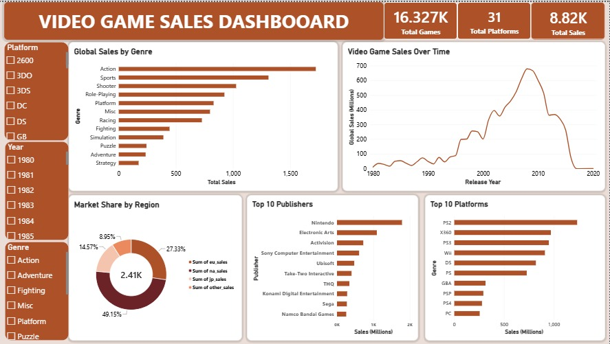

# 🎮 Video Game Sales Dashboard (Power BI)

An interactive, 2-page Power BI dashboard analyzing global video game sales from 1980 to 2020. 

## 📌 Project Overview
This project uses the Kaggle Video Game Sales dataset (16,000+ games) to explore market trends, top publishers, and regional sales distributions. It features a main dashboard for visualization and a second page dedicated to key business insights.

## 🛠️ Tools & Skills Used
- **Power BI Desktop**
- **Power Query:** Cleaned data, handled null values, and filtered out invalid years.
- **Data Modeling:** Created KPI Cards, Bar Charts, Line Charts, and Donut Charts.
- **Interactivity:** Added interactive Slicers for Platform, Genre, and Year.

## 📊 Dashboard Components (Page 1)
- **KPI Cards:** Total Games (16.3K), Total Platforms (31), Total Sales ($8.82K).
- **Market Share by Region:** Donut chart showing NA dominating with ~49% of sales.
- **Sales Over Time:** Line chart showing the massive industry boom peaking around 2008-2010.
- **Top 10 Publishers & Platforms:** Highlighting Nintendo's dominance and the PS2 as the best-selling console.
- **Global Sales by Genre:** Action and Sports lead the charts.

## 🔍 Key Insights (Page 2)
1. **North America Dominance:** NA accounts for nearly 50% of global sales.
2. **Nintendo's Reign:** Nintendo is the undisputed top publisher, with double the sales of its next competitor (Electronic Arts).
3. **The PS2 Era:** The PS2 is the highest-selling platform of all time.
4. **Industry Peak:** Global sales peaked between 2008 and 2010 before declining (likely due to the rise of mobile and digital-only games not captured in this physical sales dataset).

## 🚀 How to Use
1. Download the `.pbix` file from this repository.
2. Open it in Power BI Desktop.
3. Use the Slicers on the left to filter by Platform, Year, or Genre.
4. Navigate to the "Key Insights" tab at the bottom to read the summary.

## 👤 Author
**Emelda Okafor** — Data Analyst
